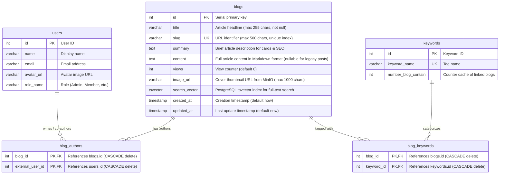

# Phase 1: Data Model Specification

**Feature**: Standalone Blog Management System with Multi-Author Support (`001-standalone-blog-system`)  
**Date**: 2026-10-14  
**Status**: Ready  

---

## 1. Entity-Relationship Diagram (ERD)



---

## 2. Table Schemas & Drizzle Definition

### Table: `blogs`

| Column | Type | Nullable | Default | Description |
|---|---|---|---|---|
| `id` | `serial` | NO | Auto-increment | Primary key |
| `title` | `varchar(255)` | NO | None | Blog post title |
| `slug` | `varchar(500)` | YES | None | Unique URL-friendly slug (`ix_blogs_slug`) |
| `summary` | `text` | YES | None | Summary / excerpt used in listings and OpenGraph |
| `content` | `text` | YES | `NULL` | Full article body written in Markdown |
| `views` | `integer` | YES | `0` | Number of article page views |
| `image_url` | `varchar(1000)`| YES | None | Cover image hosted via MinIO / S3 |
| `search_vector` | `tsvector` | YES | None | PostgreSQL full-text search index (`GIN`) |
| `created_at` | `timestamp` | YES | `now()` | Published / created timestamp |
| `updated_at` | `timestamp` | YES | `now()` | Last modification timestamp |

**Indexes**:
- `uniqueIndex('ix_blogs_slug').on(table.slug)`
- `index('ix_blogs_search_vector').using('gin', table.searchVector)`

### Table: `blog_authors`

| Column | Type | Nullable | References | Description |
|---|---|---|---|---|
| `blog_id` | `integer` | NO | `blogs.id` (`onDelete: cascade`) | Foreign key to `blogs` |
| `external_user_id` | `integer` | NO | `users.id` (`onDelete: cascade`) | Foreign key to `users` |

**Constraints**:
- Primary Key: `(blog_id, external_user_id)`

### Table: `blog_keywords`

| Column | Type | Nullable | References | Description |
|---|---|---|---|---|
| `blog_id` | `integer` | NO | `blogs.id` (`onDelete: cascade`) | Foreign key to `blogs` |
| `keyword_id` | `integer` | NO | `keywords.id` (`onDelete: cascade`) | Foreign key to `keywords` |

**Constraints**:
- Primary Key: `(blog_id, keyword_id)`

---

## 3. TypeScript Interfaces

```typescript
// frontend/lib/db/features/blogs/types.ts

export interface BlogAuthor {
  id: number
  name: string
  avatar_url?: string
}

export interface Blog {
  id: number
  slug?: string
  title: string
  summary: string
  content?: string | null  // Restored native content field
  image_url?: string
  views: number
  authors: BlogAuthor[]
  keywords: BlogKeyword[]
  created_at: string
  updated_at: string
  related_blogs?: Blog[]
}

export type BlogResponse = Blog

export interface CreateBlogInput {
  title: string
  slug?: string
  summary?: string
  content?: string
  imageUrl?: string
  authorIds?: number[]
  keywordIds?: number[]
}

export interface UpdateBlogInput extends Partial<CreateBlogInput> {
  id: number
}
```

---

## 4. Lifecycle & State Transitions

1. **Creation**:
   - Admin submits title, slug, summary, content, cover image, selected author IDs, and keyword IDs.
   - Slug uniqueness is verified. If empty, slug can be auto-derived from title.
   - Insert row into `blogs`.
   - Batch insert into `blog_authors` junction table.
   - Batch insert into `blog_keywords` junction table.
   - Increment `number_blog_contain` on associated keywords.
   - Revalidate cache tags (`revalidateTag('blogs')`).

2. **Editing**:
   - Admin modifies title, content, authors, or metadata.
   - Update `blogs` record and set `updated_at = now()`.
   - Re-sync `blog_authors`: remove unselected authors, insert newly selected authors.
   - Re-sync `blog_keywords`.
   - Revalidate cache tags.

3. **Deletion**:
   - Delete `blogs` record by ID.
   - Cascade delete automatically cleans up `blog_authors` and `blog_keywords`.
   - Decrement `number_blog_contain` on associated keywords.
   - Revalidate cache tags.

4. **Public Viewing**:
   - Reader navigates to `/blog/[slug]`.
   - Fetch post with authors and keywords from local DB.
   - If `content` is present, render via `compileMDX`.
   - If `content` is null/empty, render fallback: `*Nội dung bài viết đang được cập nhật...*`.
   - Asynchronously increment `views` counter.
