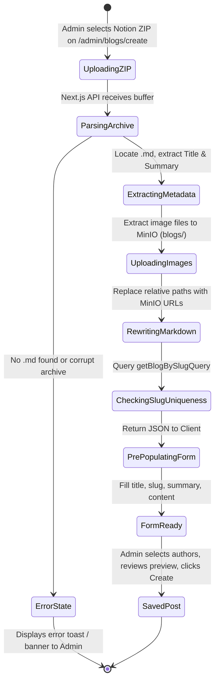

# Phase 1 Data Model: Notion ZIP Blog Post Import

**Feature**: `002-notion-zip-blog-import`  
**Date**: 2026-10-14  
**Status**: Completed  

---

## Entities & Interfaces

### 1. `NotionZipImportResult`

Represents the processed payload returned by the server-side extraction handler to the admin client.

```typescript
export interface NotionZipImportResult {
  success: boolean
  title: string
  slug: string
  isSlugDuplicate: boolean
  summary: string
  content: string
  imagesCount: number
  warnings?: string[]
  error?: string
}
```

#### Fields & Validation Rules:

| Field | Type | Required | Description & Validation |
|---|---|---|---|
| `success` | `boolean` | Yes | `true` if ZIP parsed and images uploaded without critical failure. |
| `title` | `string` | Yes | Extracted from the first `# Heading` or cleaned `.md` filename. Min length 1, trimmed. |
| `slug` | `string` | Yes | URL-friendly slug generated from title using Vietnamese transliteration and kebab-case. |
| `isSlugDuplicate` | `boolean` | Yes | `true` if `slug` already exists in `blogs` table. Triggers UI error state in `BlogForm`. |
| `summary` | `string` | Yes | First non-heading, non-image text paragraph, truncated to <= 300 characters. |
| `content` | `string` | Yes | Full Markdown content with relative image paths rewritten to public MinIO URLs. |
| `imagesCount` | `number` | Yes | Total count of embedded image assets successfully uploaded to MinIO. |
| `warnings` | `string[]` | No | Non-fatal warnings (e.g. unreferenced images, unsupported file types skipped). |
| `error` | `string` | No | Error message if processing fails (e.g. invalid zip, no `.md` found). |

---

### 2. `ExtractedZipAsset` (Internal Processing Model)

Represents an image asset found inside the archive during decompression.

```typescript
export interface ExtractedZipAsset {
  originalPath: string       // Path as stored in ZIP, e.g. "Private & Shared/Folder/image.png"
  decodedSubpath: string     // URL-decoded subpath relative to .md file, e.g. "Folder/image.png"
  fileName: string           // Base name, e.g. "image.png"
  mimeType: string           // e.g. "image/png"
  data: Buffer               // Raw binary image data
  minioUrl?: string          // Assigned after uploadToMinIO succeeds
}
```

---

### 3. Integration with Database Entity (`blogs`)

This feature does not alter the underlying PostgreSQL schema; it feeds into the existing `blogs` table and `blog_authors` relation established in Feature `001-standalone-blog-system`.

```typescript
// Existing Drizzle ORM Schema Reference:
// frontend/lib/db/features/blogs/schema.ts
export const blogs = pgTable('blogs', {
  id: uuid('id').defaultRandom().primaryKey(),
  title: varchar('title', { length: 255 }).notNull(),
  slug: varchar('slug', { length: 255 }).notNull().unique(),
  summary: text('summary'),
  content: text('content'),
  imageUrl: text('image_url'), // Left empty upon import per FR-007
  status: blogStatusEnum('status').default('draft').notNull(),
  views: integer('views').default(0).notNull(),
  createdAt: timestamp('created_at').defaultNow().notNull(),
  updatedAt: timestamp('updated_at').defaultNow().notNull(),
})
```

---

## State Transition / Lifecycle


