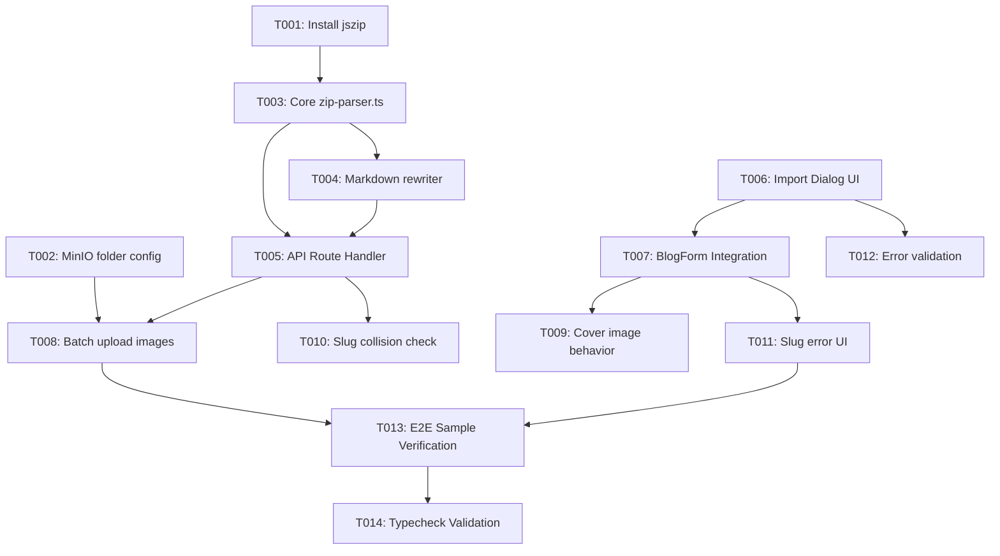

# Tasks: Notion ZIP Blog Post Import

**Feature**: `002-notion-zip-blog-import`  
**Status**: Ready for Implementation  
**Spec**: [spec.md](file:///Users/nguyenhuynh/Documents/projects/dut-ai-web/specs/002-notion-zip-blog-import/spec.md) | **Plan**: [plan.md](file:///Users/nguyenhuynh/Documents/projects/dut-ai-web/specs/002-notion-zip-blog-import/plan.md)  

---

## Phase 1: Setup (Dependencies & Infrastructure)

**Purpose**: Install required libraries and verify shared asset upload configurations.

- [x] T001 Install `jszip` dependency in `frontend/package.json`
- [x] T002 [P] Verify and update MinIO folder configuration for `blogs/` prefix in `frontend/lib/minio.ts`

---

## Phase 2: Foundational (Core Extraction & Path Rewriting Logic)

**Purpose**: Build standalone, pure TypeScript parsing and transformation utilities.

- [x] T003 [P] Implement Notion ZIP parsing, title cleaning (stripping 32-hex ID), slug generation, and summary extraction in `frontend/lib/notion/zip-parser.ts`
- [x] T004 [P] Implement URL-decoded markdown image reference resolution and URL rewriting engine in `frontend/lib/notion/zip-parser.ts`

**Checkpoint**: Core parser and transformer functions ready and unit-tested in-memory.

---

## Phase 3: User Story 1 - Import Blog Post from Notion Export ZIP (Priority: P1) 🎯 MVP

**Goal**: Admins can upload a Notion ZIP archive, extract article text, and pre-populate the `BlogForm`.

**Independent Test**: Upload `57da3f8a-e1fe-4f43-9d0e-63f9abb55d9b_ExportBlock-722b653a-bd16-4c90-a03f-c6ab043354dc.zip` on `/admin/blogs/create`. The title, slug, summary, and markdown content are automatically filled into `BlogForm`.

- [x] T005 [US1] Create API route handler for authenticated ZIP upload in `frontend/app/api/admin/blogs/import-notion/route.ts`
- [x] T006 [US1] Implement `NotionZipImportDialog` modal component with drag-and-drop file picker and progress indicator in `frontend/components/admin/NotionZipImportDialog.tsx`
- [x] T007 [US1] Integrate `NotionZipImportDialog` trigger button into `frontend/app/admin/blogs/BlogForm.tsx` and pre-populate form fields upon successful extraction

**Checkpoint**: User Story 1 MVP fully operational for text extraction and form pre-population.

---

## Phase 4: User Story 2 - Image Asset Processing and Path Transformation (Priority: P2)

**Goal**: All images in the Notion export ZIP are uploaded to MinIO storage and linked seamlessly in Markdown without broken images.

**Independent Test**: Upload Notion ZIP with 8+ images. In the MarkdownEditor preview pane, all images render with valid `https://` MinIO URLs.

- [x] T008 [US2] Implement batch image asset extraction and upload to MinIO under `blogs/` in `frontend/app/api/admin/blogs/import-notion/route.ts`
- [x] T009 [US2] Ensure cover image (`imageUrl`) field in `BlogForm` is left empty by default to trigger dynamic OpenGraph thumbnail generation per clarified FR-007 in `frontend/components/admin/NotionZipImportDialog.tsx`

**Checkpoint**: User Stories 1 and 2 deliver end-to-end content and media ingestion.

---

## Phase 5: User Story 3 - Import Error Handling & Validation Feedback (Priority: P3)

**Goal**: Provide clear error feedback for corrupted files, size limits, and inline duplicate slug conflict detection.

**Independent Test**: Upload a file with a duplicate slug; verify slug input shows a red border with validation error message, and submission is prevented until changed. Upload invalid/empty archive and verify error toast.

- [x] T010 [US3] Add slug collision check using `getBlogBySlugQuery` returning `isSlugDuplicate: boolean` in `frontend/app/api/admin/blogs/import-notion/route.ts`
- [x] T011 [US3] Add visual duplicate slug indicator (red border and error label "Slug đã tồn tại, vui lòng thay đổi") blocking form submission in `frontend/app/admin/blogs/BlogForm.tsx`
- [x] T012 [US3] Add validation for file size (<= 50MB), mime-type (.zip), and check for primary `.md` file existence with actionable error toasts in `frontend/components/admin/NotionZipImportDialog.tsx`

**Checkpoint**: All edge cases, validations, and error scenarios handled gracefully.

---

## Phase 6: Polish & Verification

**Purpose**: Full regression testing, typecheck, and validation against real archive.

- [x] T013 Execute end-to-end verification with sample archive `57da3f8a-e1fe-4f43-9d0e-63f9abb55d9b_ExportBlock-722b653a-bd16-4c90-a03f-c6ab043354dc.zip` per `quickstart.md`
- [x] T014 Run TypeScript compiler check (`npx tsc --noEmit`) to verify zero type or lint errors across the workspace

---

## Dependencies & Execution Order

### Parallel Opportunities

- **Phase 1 & 2**: T001, T002, T003, and T004 can be implemented in parallel or sequentially without cross-blocking.
- **Phase 3 & 4**: T005 and T006 can be developed in parallel as API contract and UI dialog are decoupled.
