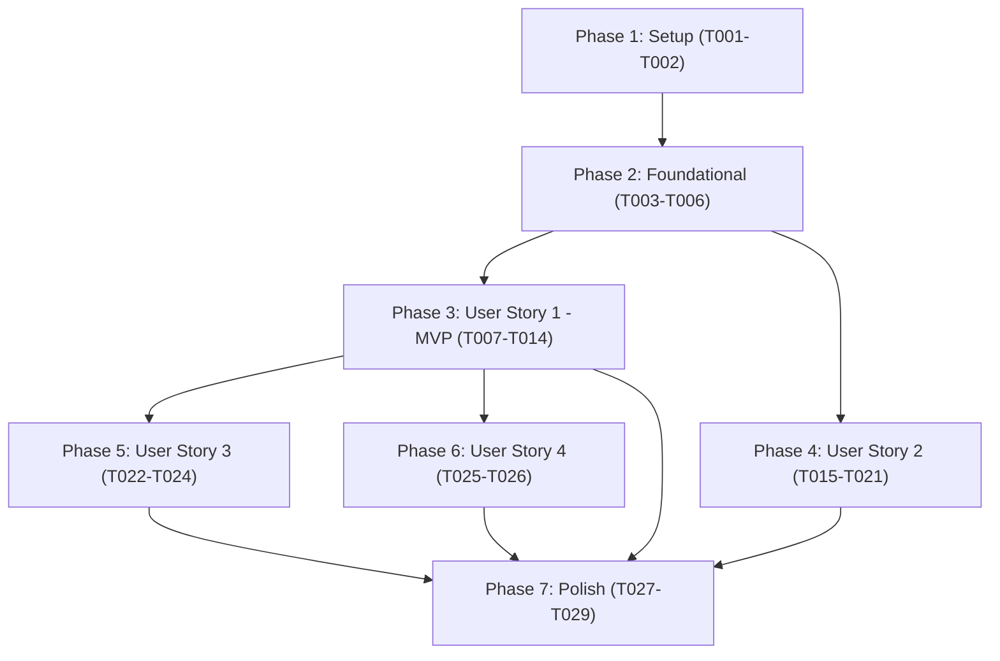

# Tasks: Member Portfolio Profiles

**Input**: Design documents from `specs/004-member-portfolios/`
**Prerequisites**: [plan.md](file:///Users/nguyenhuynh/Documents/projects/dut-ai-web/specs/004-member-portfolios/plan.md), [spec.md](file:///Users/nguyenhuynh/Documents/projects/dut-ai-web/specs/004-member-portfolios/spec.md), [research.md](file:///Users/nguyenhuynh/Documents/projects/dut-ai-web/specs/004-member-portfolios/research.md), [data-model.md](file:///Users/nguyenhuynh/Documents/projects/dut-ai-web/specs/004-member-portfolios/data-model.md), [contracts/](file:///Users/nguyenhuynh/Documents/projects/dut-ai-web/specs/004-member-portfolios/contracts)

**Organization**: Tasks are grouped by phase and user story to enable independent implementation and testing of each slice.

## Format: `- [ ] [ID] [P?] [Story?] Description with exact file path`

- **[P]**: Can run in parallel (different files, no dependencies)
- **[Story]**: Which user story this task belongs to (`[US1]`, `[US2]`, `[US3]`, `[US4]`)

---

## Phase 1: Setup (Shared Infrastructure)

**Purpose**: Utilities and shared helpers for username handling and routing rules.

- [X] T001 Create reserved usernames blocklist in `frontend/lib/portfolio/reserved-usernames.ts` containing `['admin', 'api', 'blog', 'projects', 'about', 'events', 'members', 'member', 'login', 'logout', 'dashboard', 'settings', 'user', 'users', 'auth', 'public', 'static']`
- [X] T002 [P] Create username generator and slugifier utility in `frontend/lib/portfolio/username-generator.ts` with Vietnamese accent removal, lowercasing, hyphen conversion, length limit of 24 characters, and numeric user ID fallback on collision

---

## Phase 2: Foundational (Blocking Prerequisites)

**Purpose**: Database schema expansion, migration, and core data access layers.

**⚠️ CRITICAL**: Must complete before any user story can begin.

- [X] T003 Update Drizzle ORM schema for `user_cv` and create `user_portfolio_projects` in `frontend/lib/db/features/users/schema.ts` with columns: `username: varchar(50) not null unique` (validated against `^[a-z0-9_-]{3,30}$`), `headline: varchar(255)`, `bio: text`, `avatar_url: varchar(1000)`, `github_url: varchar(500)`, `linkedin_url: varchar(500)`, `facebook_url: varchar(500)`, `website_url: varchar(500)`, `skills: jsonb default '[]'`, `cv_file_url: varchar(1000)`, `cv_file_name: varchar(255)`, `cv_file_size: integer` (max 10,485,760 bytes), `is_public: boolean not null default true`, and table `user_portfolio_projects` with index on `user_id`
- [X] T004 Update central database schema re-export in `frontend/lib/db/schema.ts` and define TypeScript interfaces (`SkillCategory`, `UserCvModel`, `UserPortfolioProjectModel`) in `frontend/lib/db/features/users/types.ts`
- [X] T005 Generate database migration `0006_member_portfolios.sql` using `npm run db:generate` in `frontend/drizzle/`
- [X] T006 [P] Implement core database queries (`getMemberPortfolioByUsernameQuery`, `upsertMemberPortfolioQuery`, `getUserPortfolioProjectsQuery`) in `frontend/lib/db/features/users/queries.ts`

**Checkpoint**: Foundational layer ready - user story implementation can now begin.

---

## Phase 3: User Story 1 - Public Member Portfolio Viewing (Priority: P1) 🎯 MVP

**Goal**: Any visitor, student, or recruiter can access `/members/[username]` to view the member's profile, bio, skills, unified projects gallery, and view/download their PDF CV in both Light and Dark modes.

**Independent Test**: Visit `/members/[username]` for an initialized member and verify that Hero, About, Skills, Projects, and Resume sections render cleanly without hydration or contrast issues.

- [X] T007 [P] [US1] Create `PortfolioHero` component in `frontend/components/portfolio/PortfolioHero.tsx` rendering member name, headline, quote, circular avatar, social links (`lucide-react`), and CTA buttons
- [X] T008 [P] [US1] Create `PortfolioAbout` component in `frontend/components/portfolio/PortfolioAbout.tsx` displaying biography and club role
- [X] T009 [P] [US1] Create `PortfolioSkills` component in `frontend/components/portfolio/PortfolioSkills.tsx` displaying categorized skill badge cards
- [X] T010 [P] [US1] Create `PortfolioProjectCard` and `PortfolioProjects` components in `frontend/components/portfolio/PortfolioProjects.tsx` displaying unified projects grid with club badges, demo links, and repository links
- [X] T011 [P] [US1] Create `PortfolioResume` component in `frontend/components/portfolio/PortfolioResume.tsx` with native `<object>` / `<iframe>` desktop embed and mobile download button
- [X] T012 [US1] Implement public API endpoint `GET /api/members/[username]` in `frontend/app/api/members/[username]/route.ts` returning aggregated profile data or 404
- [X] T013 [US1] Implement public dynamic page route in `frontend/app/members/[username]/page.tsx` integrating all portfolio subcomponents with dynamic `generateMetadata` for SEO and OpenGraph social cards
- [X] T014 [P] [US1] Create `not-found.tsx` and `loading.tsx` in `frontend/app/members/[username]/not-found.tsx` and `frontend/app/members/[username]/loading.tsx`

**Checkpoint**: User Story 1 is functional as an independent MVP.

---

## Phase 4: User Story 2 - Member Portfolio Profile & CV Management (Priority: P2)

**Goal**: Authenticated members can edit their personal portfolio (custom username, bio, skills, social links), upload/remove their PDF CV, and manage personal projects via the dashboard.

**Independent Test**: Log in, navigate to `/admin/portfolio`, update profile fields, upload a PDF CV (< 10MB), save changes, and observe the updates on `/members/[username]`.

- [X] T015 [US2] Implement authenticated API endpoint `GET/PUT /api/members/me/portfolio` in `frontend/app/api/members/me/portfolio/route.ts` with Zod validation for username `^[a-z0-9_-]{3,30}$` and reserved keyword check
- [X] T016 [US2] Implement authenticated CV upload and delete API endpoint `POST/DELETE /api/members/me/cv` in `frontend/app/api/members/me/cv/route.ts` validating PDF MIME `application/pdf`, max size `10485760` bytes (10MB), uploading to MinIO folder `resumes` via `uploadToMinIO`
- [X] T017 [US2] Implement personal project CRUD API endpoints in `frontend/app/api/members/me/projects/route.ts` and `frontend/app/api/members/me/projects/[id]/route.ts`
- [X] T018 [P] [US2] Create `CvUploader` component in `frontend/components/admin/portfolio/CvUploader.tsx` with drag-and-drop, PDF validation, upload progress, and remove action
- [X] T019 [P] [US2] Create `PortfolioEditForm` component in `frontend/components/admin/portfolio/PortfolioEditForm.tsx` with debounced username uniqueness check and skill tag input
- [X] T020 [P] [US2] Create `PersonalProjectsManager` component in `frontend/components/admin/portfolio/PersonalProjectsManager.tsx` allowing members to add, edit, and delete personal projects
- [X] T021 [US2] Build member portfolio management page at `frontend/app/admin/portfolio/page.tsx` integrating the edit form, CV uploader, and personal projects manager

**Checkpoint**: User Stories 1 AND 2 work seamlessly together.

---

## Phase 5: User Story 3 - Automatic Project Synchronization (Priority: P3)

**Goal**: The system automatically queries and joins projects from `projects` and `project_members` for the member's `externalUserId`, merging them with personal projects into the unified `projects` array.

**Independent Test**: Link a member to a club project in `project_members` and verify the project appears with the "DUT AI Club Verified" badge and member role in `/members/[username]`.

- [X] T022 [US3] Implement `getMemberClubProjectsQuery` in `frontend/lib/db/features/users/queries.ts` joining `projects` and `project_members` on `projects.id = project_members.project_id` where `project_members.external_user_id = user_id`
- [X] T023 [US3] Implement unified project aggregator in `frontend/lib/db/features/users/queries.ts` merging club projects (`is_club_project: true` and `role`) and personal projects (`is_club_project: false`) into a single cohesive list
- [X] T024 [US3] Connect unified project aggregator into `GET /api/members/[username]` in `frontend/app/api/members/[username]/route.ts` and Server Component in `frontend/app/members/[username]/page.tsx`

**Checkpoint**: Verified club projects appear alongside personal projects in the unified showcase.

---

## Phase 6: User Story 4 - Discovery from Member Directory (Priority: P4)

**Goal**: Visitors browsing the club's "About" page can click on any member's card to navigate directly to their personal portfolio.

**Independent Test**: Navigate to `/about`, click on a member in the Generation Album, and confirm navigation to `/members/[username]`.

- [X] T025 [US4] Update `frontend/lib/db/features/organization/queries.ts` to include `username` in member album data mapping from `user_cv`
- [X] T026 [US4] Update member card component in `frontend/components/about/GenerationAlbum.tsx` to link member avatars and names to `/members/[username]`

---

## Phase 7: Polish & Cross-Cutting Concerns

**Purpose**: Cross-story quality, theme adherence, and validation.

- [X] T027 [P] Polish responsive layout and verify WCAG AA color contrast across Light and Dark themes for all portfolio components in `frontend/components/portfolio/`
- [X] T028 Execute complete quickstart validation scenarios from `specs/004-member-portfolios/quickstart.md`
- [X] T029 Run linter and type-checker via `npm run lint` in `frontend/` to ensure zero errors and clean build

---

## Dependencies & Execution Order

### Phase Dependencies

### Parallel Opportunities

- **Phase 1**: T001 and T002 can execute in parallel.
- **Phase 2**: T006 can execute in parallel once T003/T004 schema definition is complete.
- **Phase 3 (US1)**: UI components T007, T008, T009, T010, T011, and T014 can all be created in parallel.
- **Phase 4 (US2)**: Admin UI components T018, T019, T020 can be developed in parallel with API routes T015, T016, T017.

---

## Implementation Strategy: MVP First

1. **Step 1**: Complete Setup (T001-T002) & Foundational (T003-T006).
2. **Step 2**: Implement User Story 1 (T007-T014).
3. **Step 3 (MVP Checkpoint)**: Verify `/members/[username]` renders the public portfolio.
4. **Step 4**: Implement User Story 2 (T015-T021) for self-service profile and CV upload.
5. **Step 5**: Implement User Story 3 (T022-T024) for automatic club project synchronization.
6. **Step 6**: Implement User Story 4 (T025-T026) for directory discovery.
7. **Step 7**: Polish, responsive design review, and lint check (T027-T029).
